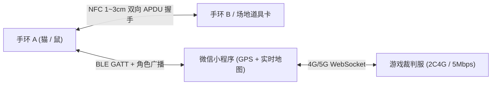

# CatMouse Band (猫鼠手环 V1.5)

面向线下真人社交与户外对抗（猫抓老鼠、阵营感染、据点夺旗）的**智能穿戴手环硬件方案与 ESP32-C3 固件**。

通过 **NFC 双模碰一碰交互（读卡 + 卡模拟） + 碰撞检测 + 高亮 RGB 灯环 + 振感音效 + 微信小程序互联**，把传统“口头扯皮、天黑看不清、玩法单一”的猫抓老鼠升级成有裁判、有道具、有声光反馈的线下真人游戏平台。

---

## 核心特性

- **双模 NFC 碰一碰判定（零扯皮）**：每只手环均搭载 PN532，支持在 **Poll（读卡器）** 与 **Listen（卡模拟）** 之间按角色动态切换——猫抓鼠、自由鼠解救牢房队友、拾取场地 NTAG215 道具卡、手机碰一碰绑定手环一套硬件全覆盖。
- **碰撞唤醒低功耗射频窗口**：平时关闭 NFC 射频省电；LIS2DH12 加速度计检测到碰触冲击（或短按侧键）时自动开启 1.5 秒 NFC 握手窗口，兼顾干脆的交互仪式感与续航。
- **全场角色灯效与近场心跳预警**：12 颗高亮可编程 RGB 灯珠支持双层渲染（常驻阵营底色 + 抓捕/拾取临时爆闪）；连上宿主手机后自动切换为不可连接 BLE 广播，供周围鼠玩家扫描猫的距离并触发手环“心跳振动”。
- **免小程序脱机试玩模式（`STANDALONE`）**：内置本地猫鼠状态机，拿到两只以上原型手环即可直接双击切换角色，现场体验抓捕入狱与碰触解救。

---

## 系统架构



- **手环端（本目录 `hardware/`）**：负责碰撞检测、NFC 抓捕/解救/读道具卡、RGB 灯环、马达振动、蜂鸣音效与实体按键。
- **小程序端（仓库根目录）**：已完成原生实时地图、前台 GPS 定位、动态码兜底、鼠队视野共享与赛后轨迹海报；后续可接入本目录的 BLE GATT 协议联动手环。
- **服务端（`cat-mouse-server/`）**：已实现 v2 房间与规则裁决（50 m GPS 距离与 5 s 新鲜度校验）；接入硬件后复用 `/api/v2/rooms/:id/capture` 并扩展 NFC 凭证去重。

---

## 目录结构

```text
hardware/
├── README.md                   # 硬件模块总览与快速上手指南
├── docs/
│   ├── V1.5-硬件规格.md        # 硬件选型、PN532 双模机制、接线定义、功耗预算与测试指标
│   ├── 通信协议.md             # BLE GATT 指令/事件定义、广播包格式、NFC APDU 与 NDEF 协议
│   └── 原型采购清单.csv        # 10 套（含 2 套备件）免画板原型的采购物料表
├── firmware/                   # Seeed XIAO ESP32C3 完整固件工程 (PlatformIO + Arduino)
│   ├── platformio.ini          # 编译环境与依赖库配置 (NimBLE + Adafruit NeoPixel)
│   ├── include/
│   │   ├── config.h            # GPIO 引脚映射、灯环亮度、碰撞阈值与时间窗口参数
│   │   ├── protocol.h          # 角色枚举、14 条 BLE 指令码、9 类事件码与振感音效 ID
│   │   ├── pn532.h             # 精简版 PN532 I2C 驱动接口（Initiator + Target 卡模拟）
│   │   ├── nfc_manager.h       # FreeRTOS NFC 角色窗口调度器接口
│   │   ├── imu.h               # LIS2DH12 硬件高通滤波碰撞检测接口
│   │   ├── peripherals.h       # 灯环、马达、蜂鸣器、按键、电池采样接口
│   │   ├── ble_service.h       # BLE GATT 服务与动态广播接口
│   │   └── bus.h               # I2C 总线互斥锁封装
│   └── src/                    # 各模块实现与主状态机 (main.cpp)
└── tests/
    └── verify_firmware.py      # 源码结构、引脚约束、协议一致性与 NFC 握手全链路仿真测试
```

---

## 原型硬件速查（XIAO ESP32C3）

详细物料与注意事项请查阅 [docs/V1.5-硬件规格.md](docs/V1.5-硬件规格.md) 与 [docs/原型采购清单.csv](docs/原型采购清单.csv)。

| XIAO 引脚 | GPIO | 外设连接 | 备注 |
|---|---|---|---|
| `D4` / `D5` | `GPIO6` / `GPIO7` | I2C `SDA` / `SCL` → LIS2DH12 + PN532 | PN532 拨码开关需拨至 I2C 模式 |
| `D1` | `GPIO3` | LIS2DH12 `INT1` | 碰撞中断输入 |
| `D2` | `GPIO4` | 侧按轻触开关 → `GND` | 内部上拉，支持深度睡眠按键唤醒 |
| `D0` | `GPIO2` | 电池分压采样（`2 × 200 kΩ`） | ADC1 测锂电池电压 |
| `D3` | `GPIO5` | `AO3400` 栅极 → 1027 扁平马达 | 马达两端反并 `1N4148` 续流二极管 |
| `D6` | `GPIO21` | WS2812B 12 位灯环 `DIN`（串 `330 Ω`） | 灯环 `VDD` 接电池正极（经电源开关） |
| `D7` | `GPIO20` | 无源贴片蜂鸣器（经 `S8050` 驱动） | PWM 音效输出 |
| `D10` | `GPIO10` | PN532 `RSTPDN`（可选） | 硬件复位引脚 |

---

## 快速编译、烧录与测试

### 1. 编译与烧录固件

安装 [PlatformIO](https://platformio.org/) 后在 `firmware/` 目录下执行：

```bash
cd firmware
pio run                 # 编译 ESP32-C3 固件
pio run -t upload       # 通过 USB-C 烧录至 Seeed XIAO ESP32C3
pio device monitor      # 打开 115200 串口日志查看外设自检状态
```

### 2. 运行协议与固件校验测试

无需连接硬件即可在本地验证引脚约束、协议表一致性及 PN532 / APDU / NDEF 状态机：

```bash
python tests/verify_firmware.py
```

### 3. 脱机免手机实测流程

1. **切换身份**：未连手机时**双击按键**循环切换角色：
   `大厅（白灯慢闪）` → `猫（红灯旋转）` → `自由鼠（绿灯呼吸）` → `被抓鼠（蓝灯闪烁）`
2. **猫抓鼠**：将“猫”手环与“自由鼠”手环轻碰并贴合 **0.5 秒** —— 猫手环橙光爆闪提示抓捕成功，鼠手环红光长振报警并自动变为**被抓鼠（蓝灯闪烁）**。
3. **解救队友**：另一只“自由鼠”手环碰触“被抓鼠”手环 **0.5 秒** —— 被抓鼠绿光闪烁伴随三连递增音效，恢复为**自由鼠（绿灯呼吸）**。
4. **刷道具卡**：短按或轻敲手环后贴近 NTAG215 卡片，触发金光闪烁与道具音效。
5. **手机碰一碰绑定**：大厅状态下**长按按键 1.2 秒**（黄灯呼吸 30 秒），用 iPhone 或 Android 手机贴近手环即可读取 NDEF 绑定链接。
6. **深度睡眠关机**：按住按键 **4 秒**进入微安级休眠，再次短按唤醒。

---

## Roadmap

- [x] V1.5 硬件选型、双模 NFC 架构与物料清单
- [x] BLE + NFC 双向握手、NDEF 绑定与 `api/v2` 对接协议定义
- [x] ESP32-C3 手环固件与脱机猫鼠规则实现
- [ ] 3D 打印外壳与乳白导光罩结构文件
- [ ] 微信小程序 BLE 桥接模块（对接现有 `pages/map` 与 `utils/v2.js`）
- [ ] 后端 `api/v2` 扩展 NFC 抓捕/解救/道具凭证裁决接口
