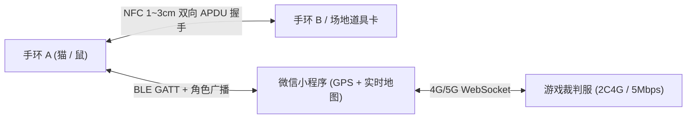

# CatMouse Band (猫鼠手环 V1.5)

面向线下真人社交与户外对抗（猫抓老鼠、阵营感染、据点夺旗）的**智能穿戴手环硬件方案与 ESP32-C3 固件**。

通过 **NFC 双模碰一碰交互（读卡 + 卡模拟） + 碰撞检测 + 高亮 RGB 灯环 + 振感音效 + 微信小程序互联**，把传统“口头扯皮、天黑看不清、玩法单一”的猫抓老鼠升级成有裁判、有道具、有声光反馈的线下真人游戏平台。

---

## 核心特性

- **双模 NFC 碰一碰判定（零扯皮）**：每只手环均搭载 PN532，支持在 **Poll（读卡器）** 与 **Listen（卡模拟）** 之间按角色动态切换——猫抓鼠、自由鼠解救牢房队友、拾取场地 NTAG215 道具卡、手机碰一碰绑定手环一套硬件全覆盖。
- **碰撞唤醒低功耗射频窗口**：平时关闭 NFC 射频省电；LIS2DH12 加速度计检测到碰触冲击（或短按侧键）时自动开启 1.5 秒 NFC 握手窗口，兼顾干脆的交互仪式感与续航。
- **全场角色灯效与近场心跳预警**：12 颗高亮可编程 RGB 灯珠支持双层渲染（常驻阵营底色 + 抓捕/拾取临时爆闪）；连上宿主手机后自动切换为不可连接 BLE 广播，供周围鼠玩家扫描猫的距离并触发手环“心跳振动”。
- **免小程序脱机试玩模式（`STANDALONE`）**：内置本地猫鼠状态机，拿到两只以上原型手环即可直接双击切换角色，现场体验抓捕入狱与碰触解救。

---

## 系统架构



- **手环端（本目录 `hardware/`）**：负责碰撞检测、NFC 抓捕/解救/读道具卡、RGB 灯环、马达振动、蜂鸣音效与实体按键。
- **小程序端（仓库根目录）**：已完成原生实时地图、前台 GPS 定位、动态码兜底、鼠队视野共享与赛后轨迹海报；后续可接入本目录的 BLE GATT 协议联动手环。
- **服务端（`cat-mouse-server/`）**：已实现 v2 房间与规则裁决（50 m GPS 距离与 5 s 新鲜度校验）；接入硬件后复用 `/api/v2/rooms/:id/capture` 并扩展 NFC 凭证去重。

---

## 目录结构

```text
hardware/
├── README.md                   # 硬件模块总览、仿真运行与快速上手指南
├── docs/
│   ├── 硬件架构设计基线.md      # V1.5 冻结硬件架构、五道电气保护与 POC→EVT→MP 演进路线
│   ├── Strap-Halo-EVT-A-机电变更.md # EVT-A 机电 ECO（12.15mm 顶腔、BLE 铣空槽、FH19C 补强舌、磁吸四线 FPC）
│   ├── PCB与3D结构协同布局规范.md # EVT-A 主板轮廓、BLE 铣槽全净空、NFC 隔离、单面 L1 分区与 17 件 3D 机电接口规范
│   ├── 4层PCB设计与检视说明.md  # KiCad 10 4层紧凑主板叠层、RF净空、嘉立创工艺与引脚对齐表
│   ├── V1.5-硬件规格.md        # 硬件选型、PN532 双模机制、接线定义、功耗预算与测试指标
│   ├── 通信协议.md             # BLE GATT 指令/事件定义、广播包格式、NFC APDU 与 NDEF 协议
│   ├── 产品设计方案.md          # ID/MD 三层叠层、声光触觉盲操矩阵、道具卡生态与 20 联充电箱
│   ├── 产品报价与财务分析.md    # 10/100/1000/5000 套阶梯报价、B/C 端商业定价与盈亏平衡测算
│   ├── BOM与报价测算.csv        # 四阶段元器件、PCBA、模具、充电箱精细化成本明细表
│   └── 原型采购清单.csv         # 10 套（含 2 套备件）免画板原型的淘宝/立创采购物料表
├── design/                     # Strap-Halo 腕带光环版工业设计 (ID) 高清渲染图
│   └── renders/                # 三阵营腕带光环主图、Pin-and-Tuck 变体、户外夜跑双环碰触场景图
├── cad/                        # EVT-A 17 零件参数化 3D CAD 装配体（双版本）与 Autodesk Fusion 360 原生工程
│   ├── README.md               # Fusion 360 两种打开方式（STEP 直开 / Shift+S 原生脚本）与双版本说明
│   ├── strap_halo_geometry.py  # 3D CAD 与 KiCad 主板/磁吸 FPC 共享的 EVT-A 毫米级轮廓单源定义
│   ├── build_catmouse_cad.py   # V1.5 EVT-A 量产针扣版 17 零件建模（含 FH19C + 17 号磁吸 FPC）与 0.000 mm³ 校验
│   ├── build_catmouse_velcro_cad.py # V1.5-Lite EVT-A 120–200mm 非对称魔术贴简版 17 零件建模与 0.000 mm³ 校验
│   ├── render_cad_views.py     # 主线 6 组 EVT-A 3D 工程图 + 内部连接 4 视角微距特写渲染脚本
│   ├── render_velcro_views.py  # 魔术贴简版 EVT-A 4 视角 3D 渲染 + 120–200mm 腕围遮盖/粘合分析图脚本
│   ├── fusion360/              # 双版本 100% 原生参数化 EVT-A Fusion 360 脚本（17 组件）
│   ├── output/                 # CatMouseBand_V15_StrapHalo.step + CatMouseBand_V15_Velcro_Lite.step + 校验报告
│   └── renders/                # 8 张高清 EVT-A 工程图（含 cad_06 内部连接详图、cad_velcro_01/02 魔术贴分析图）
├── pcb/                        # KiCad 10.0 EVT-A 四层主板、磁吸四线 FPC 与历史参考设计
│   ├── catmouse-band-v15-strap-halo/ # EVT-A 四层主板 KiCad 工程 (28.4×35.4mm，含 BLE 铣空槽，ERC=0，13/13 引脚一致)
│   ├── catmouse-band-v15-pogo-flex/  # EVT-A 磁吸四线 C 弯柔性转接板（绕马达 0.125mm，0 ERC/0 DRC，含打样 Gerber ZIP）
│   ├── catmouse-band-v15/      # 历史 40×46mm 4层参考板 + 嘉立创打样包
│   ├── generate_strap_halo_*.py / generate_pogo_interposer.py / verify_strap_halo.py # EVT-A PCB 生成与校验脚本
├── firmware/                   # Seeed XIAO ESP32C3 & EVT 4层主板双目标固件工程 (PlatformIO)
│   ├── platformio.ini          # [env:xiao_esp32c3] 原型 + [env:evt_4layer_pcb] 4层定制主板
│   ├── include/                # 引脚配置、协议码、驱动接口
│   └── src/                    # 8 个核心固件源码（含 GPIO8 灯环断电、LVP 过放保护、I2C 自愈、产测 CLI）
├── scripts/
│   └── flash_and_test.ps1      # 一键编译、批量烧录与串口自动化产测脚本
├── sim/                        # 真实 C++17 多手环硬件在环（Firmware-in-the-Loop）仿真系统
│   ├── hal/                    # 虚拟 LIS2DH12 / PN532 / NimBLE / NeoPixel / FreeRTOS 芯片层
│   ├── build_sim.py            # 直接编译全部 8 个真实 firmware/src/*.cpp 成 band_node.exe
│   ├── run_hil_sim.py          # 4 进程真固件联调仿真（碰撞/NFC/解救/道具/50m GPS/深睡/续航）
│   └── run_evt_virtual_flash_and_hil.py # EVT 4层主板虚拟烧录 (USB-JTAG) + GPIO8 PMOS 断电全链路联调
└── tests/
    └── verify_firmware.py      # 源码结构、引脚约束、协议一致性与状态机静态校验
```

---

## 原型硬件速查（XIAO ESP32C3）

详细物料与注意事项请查阅 [docs/V1.5-硬件规格.md](docs/V1.5-硬件规格.md) 与 [docs/原型采购清单.csv](docs/原型采购清单.csv)。

| XIAO 引脚 | GPIO | 外设连接 | 备注 |
|---|---|---|---|
| `D4` / `D5` | `GPIO6` / `GPIO7` | I2C `SDA` / `SCL` → LIS2DH12 + PN532 | PN532 拨码开关需拨至 I2C 模式 |
| `D1` | `GPIO3` | LIS2DH12 `INT1` | 碰撞中断输入 |
| `D2` | `GPIO4` | 侧按轻触开关 → `GND` | 内部上拉，支持深度睡眠按键唤醒 |
| `D0` | `GPIO2` | 电池分压采样（`2 × 200 kΩ`） | ADC1 测锂电池电压 |
| `D3` | `GPIO5` | `AO3400` 栅极 → 1027 扁平马达 | 马达两端反并 `1N4148` 续流二极管 |
| `D6` | `GPIO21` | WS2812B 12 位灯环 `DIN`（串 `330 Ω`） | 灯环 `VDD` 接电池正极（经电源开关） |
| `D7` | `GPIO20` | 无源贴片蜂鸣器（经 `S8050` 驱动） | PWM 音效输出 |
| `D10` | `GPIO10` | PN532 `RSTPDN`（可选） | 硬件复位引脚 |

---

## 快速编译、烧录与测试

### 1. 编译、烧录与单板自动化产测

安装 [PlatformIO](https://platformio.org/) 后可使用一键脚本（自动将工具链缓存指向 D 盘）或在 `firmware/` 目录下执行：

```powershell
# 一键编译 / 烧录 / 串口自动产测（验证 IMU + PN532 + 电量 + 声光）
.\scripts\flash_and_test.ps1 -Action build
.\scripts\flash_and_test.ps1 -Action flash -Port COM5
.\scripts\flash_and_test.ps1 -Action selftest -Port COM5
```

### 2. 运行真实 C++17 多手环硬件在环仿真与 EVT 4 层主板虚拟烧录联调

无需实物硬件即可直接编译全部 8 个真实 `firmware/src/*.cpp` 文件，模拟通过背面 4-pin 磁吸口原生 USB-JTAG 烧录至 4 层定制主板（启用 `GPIO8` 高边 PMOS 断电与 `400 kHz` I2C），并拉起 4 个独立手环进程跑通完整对局仿真：

```bash
python pcb/verify_netlist_vs_firmware.py     # KiCad 10 官方网表 <-> EVT 固件 12 引脚对齐校验
python sim/run_evt_virtual_flash_and_hil.py  # 编译 EVT 固件 + 虚拟烧录 + 6 大场景 + PMOS 断电联调
python tests/verify_firmware.py              # 固件静态结构与协议一致性校验
```

### 3. 脱机免手机实测流程

1. **切换身份**：未连手机时**双击按键**循环切换角色：
   `大厅（白灯慢闪）` → `猫（红灯旋转）` → `自由鼠（绿灯呼吸）` → `被抓鼠（蓝灯闪烁）`
2. **猫抓鼠**：将“猫”手环与“自由鼠”手环轻碰并贴合 **0.5 秒** —— 猫手环橙光爆闪提示抓捕成功，鼠手环红光长振报警并自动变为**被抓鼠（蓝灯闪烁）**。
3. **解救队友**：另一只“自由鼠”手环碰触“被抓鼠”手环 **0.5 秒** —— 被抓鼠绿光闪烁伴随三连递增音效，恢复为**自由鼠（绿灯呼吸）**。
4. **刷道具卡**：短按或轻敲手环后贴近 NTAG215 卡片，触发金光闪烁与道具音效。
5. **手机碰一碰绑定**：大厅状态下**长按按键 1.2 秒**（黄灯呼吸 30 秒），用 iPhone 或 Android 手机贴近手环即可读取 NDEF 绑定链接。
6. **深度睡眠关机**：按住按键 **4 秒**进入微安级休眠，再次短按唤醒。

---

## Roadmap

- [x] V1.5 硬件选型、双模 NFC 架构与物料清单
- [x] BLE + NFC 双向握手、NDEF 绑定与 `api/v2` 对接协议定义
- [x] ESP32-C3 手环固件与脱机猫鼠规则实现
- [x] EVT-A 双版本 17 零件 3D CAD（STEP / Fusion 360）与磁吸四线 FPC 打样包
- [ ] EVT-A 4 层主板剩余飞线连通与嘉立创电阻配料投板
- [ ] 微信小程序 BLE 桥接模块（对接现有 `pages/map` 与 `utils/v2.js`）
- [ ] 后端 `api/v2` 扩展 NFC 抓捕/解救/道具凭证裁决接口
