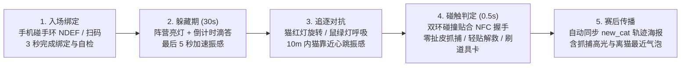

# 猫鼠手环 V1.5 产品设计方案（ID / MD / 交互 / B端配套）

> 目标场景：户外 20 人 / 20 分钟一局（一场活动 4–6 局，约 2 小时），全员携手机，兼容夜间荧光与白天户外公园/校园/营地。  
> 配套软件：微信小程序 `new_cat`（`codex/general-native-map` 原生地图 + `api/v2`）。

---

## 1. 产品定位与核心价值

**一句话定义：** 面向线下实景社交的**“真人游戏穿戴手柄”** —— 以“猫抓老鼠”为首发爆款玩法，通过同一套可编程手环支持感染模式、据点夺旗、实景狼人杀等持续扩展。

### 核心体验闭环（用户旅程）



---

## 2. 工业设计（ID）与结构叠层（MD）

### 2.1 外形与人因目标

| 指标 | 10 套手焊原型（POC） | 100 套试产（EVT） | 1,000+ 套量产（MP） |
|---|---|---|---|
| **主机外形** | 圆形 Φ46 mm × 厚 17 mm | 圆形 Φ43 mm × 厚 14.5 mm | 跑道圆/圆形 **Φ42 mm × 厚 13.5 mm** |
| **整机重量（含腕带）** | ~45 g | ~38 g | **≤ 35 g**（狂奔无坠腕感） |
| **表壳材质** | 嘉立创黑树脂 + 乳白光敏树脂 3D 打印 | CNC ABS/PC + 硅胶复模 | 双色注塑 ABS+PC 磨砂防滑 + TPU 防撞外圈 |
| **防水防摔** | IP54（防汗/防泼溅） | IP54 | **IP65**（防雨淋/1.5m 水泥地跌落） |
| **腕带** | 20 mm 魔术贴尼龙带 | 20 mm 快拆弹力魔术贴 | 20 mm 液态硅胶 / 夜间反光魔术贴双选（可水洗消毒） |

### 2.2 三层紧凑内部叠层（解决 NFC 金属屏蔽与白天亮度的关键）

```text
         ┌────────────────────────────────────────┐  ← 顶层光学区
         │   乳白雾面 PC 导光罩 (厚 1.5mm)         │     360° 柔和泛光 + 侧边可看
         │  [环形 NFC FPC 线圈 (外圈)]  [12颗灯环] │     NFC 线圈环绕灯环外缘，直面外部读距最优
         ├════════════════════════════════════════┤  ← 0.2mm 导磁铁氧体屏蔽片（必加！）
         │      主控 PCBA (ESP32-C3 + PN7160      │     隔离电池铝塑膜对 13.56MHz 磁场的涡流衰减
         │      + LIS2DH12 + 蜂鸣器 + 侧按键)      │  ← 中层电子区
         ├────────────────────────────────────────┤
         │  300~350mAh 锂电池 (带 NTC 温控保护板)  │  ← 底层动力与触觉区
         │  [1027 振动马达紧贴底壳内壁] [磁吸触点]  │     马达贴近皮肤侧，奔跑振感直达手腕
         └────────────────────────────────────────┘
```

**四个关键结构细节：**
1. **白天户外可视性光学设计**：纯裸灯珠在正午阳光下极易发白看不清。顶盖采用**乳白高透雾面 PC 扩散罩 + 内圈黑色遮光挡壁（提升对比度）**，配合固件动态亮度（白天可一键切 80% 高亮 / 夜间默认 40% 柔光不刺眼），确保白天 10–15 米外依然清晰分辨红/绿/蓝阵营。
2. **NFC 碰触区域视觉引导**：顶盖中央印有简洁的“猫爪/闪电”磨砂触碰图标，引导玩家“**两只手环表盘对表盘贴合 0.5 秒**”，正好让环形 FPC 天线平行耦合，实测握手成功率最大化。
3. **防误触侧键设计**：采用**微内凹硅胶防水按键**置于表壳右侧（靠近虎口避让手腕弯曲压迫），跑步甩臂或摔倒撑地不会误触发；短按开窗、双击切换（脱机）、长按 1.2s 绑定、长按 4s 关机。
4. **底壳激光镭雕唯一编码与兜底二维码**：背面雕刻 `CMB-XXXX` 短编号和绑定二维码，即使遇到极少数老旧机型无 NFC 或用户关闭 NFC，微信扫码 2 秒兜底绑定。

---

## 3. 声光触觉“盲操”交互语言矩阵

玩家奔跑时无法盯着手机屏幕，全套交互设计做到**“不看手机、十米看灯、贴腕感振、听声辨事”**：

| 游戏阶段 / 状态 | 灯环常驻 / 叠加效果 | 振动模式 (`PAT_*`) | 蜂鸣器乐句 | NFC 窗口行为 |
|---|---|---|---|---|
| **大厅 · 未连手机** | 白色慢闪 | — | — | 长按 1.2s 开 30s 绑定窗 |
| **大厅 · 已连待开局** | 青色呼吸 | 连接轻振 `TICK` | 短嘀 | 同上（支持手机碰一碰绑定） |
| **大厅 · 手机碰一碰绑定** | 琥珀黄呼吸 (30s) → 成功绿灯常亮 0.8s | 绑定成功 `START` | 上行双音 | 全程 NDEF Listen |
| **30 秒躲藏倒计时** | 本局阵营色呼吸 + 最后 5 秒白光频闪 | 倒计时 `COUNTDOWN` | 滴答加速 | 暂不判抓（可预热） |
| **追逐 · 猫 (`CAT`)** | **红色单尾旋转**（强攻击感） | — | — | 碰撞/短按开启 1.5s **Poll** |
| **追逐 · 自由鼠 (`MOUSE`)** | **绿色呼吸**（安全感） | — | — | 碰撞/短按 1.5s **Listen(600ms)/Poll(300ms)交替** |
| **近距预警（猫在 10m 内）** | 鼠灯环叠加短暂红光脉冲 | **心跳双振** `HEARTBEAT` | 低频心跳声 | 由 BLE 不可连接广播 RSSI 或服务端触发 |
| **猫抓捕成功** | 橙金爆闪 0.6s | 短+长凯旋 `CATCH_OK` | 三音上行凯旋 | 3s 防重放冷却 |
| **鼠被抓入狱 (`JAILED`)** | 红光爆闪 → **蓝色闪烁求救** | 长振报警 `CAUGHT` (700ms) | 三音下行警报 | **原地自动周期被动 Listen**（免撞，队友轻贴即救） |
| **队友碰触解救成功** | 青绿爆闪 0.6s → 恢复绿色呼吸 | 三连递增 `RESCUED` | 欢快大三和弦 | 恢复自由鼠角色 |
| **刷场地 NTAG215 道具卡** | 金光爆闪 0.45s（隐身卡随后灭灯断电） | 轻快三连 `ITEM` | 拾取叮咚音 | 上报卡号 + 8 字节道具载荷 |
| **低电告警 / 过放保护** | 红光快闪 | 双振 `DOUBLE` / 报错 `ERROR` | 警报音 | `<3.55V` 告警；`<3.30V` 连续 3 次自动深睡 |

---

## 4. 场地实体道具卡生态（极低成本极大拉高复购）

每张标准 NTAG215 防水卡片/挂牌成本仅 **¥0.8–1.5**，一套活动配 12–20 张挂在公园树干、长椅、石墩上，即可把“纯跑步追逐”升级成有策略博弈的实景战术游戏：

| 道具类型码 (`itemType`) | 道具名称 | 触发效果（固件 + 小程序联动） | 战术价值 |
|---|---|---|---|
| `0x01` | **隐身披风卡** | 手环熄灭灯环并切断灯环供电 30 秒 + 小程序地图对猫隐藏坐标 30 秒 | 鼠方反杀/绕后救人核心道具 |
| `0x02` | **全图雷达卡** | 手机端高亮显示最近 2 名敌方精确位置 15 秒 + 手环青光脉冲 | 打破僵局，避免最后 5 分钟找不到人 |
| `0x03` | **护盾抵消卡** | 鼠获得一次免死护盾（猫下次碰触抵消护盾并触发 10 秒冷却） | 鼓励大胆走位与冒险解救队友 |
| `0x04` | **安全屋 / 复活点** | 固定部署在场地的据点卡，被抓鼠在限定时间内跑到指定据点刷卡自救 | 适配人数较少的 6–10 人局 |
| `0x05` | **能量补给 / 积分宝箱** | 刷卡获得积分，最终结算生成“拾荒王 / 战术 MVP”称号写入轨迹海报 | 让跑得慢的新手也有极强参与感 |

---

## 5. B 端商业运营必备配套：20 联便携充电收纳箱

面向团建公司、研学营地、高校社团和景区，客户最怕的不是玩不好，而是**“20 只手环一根根插线充电半小时、丢两只找不到、发给玩家要折腾 20 分钟配对”**。因此从 EVT/MP 起将手环打包为**“20 只成套作战箱”**交付：

- **规格**：手提防水拉杆/仪器箱（约 420 × 320 × 120 mm，满载约 2.6 kg），内衬 EVA 定制 20 孔凹槽 + 道具卡袋 + 备用腕带槽。
- **一线多充**：箱内集成 1 块 5V/12A（60W）电源模块 + 20 路带过流保护的磁吸 Pogo-Pin 充电座，**活动结束把 20 只手环按编号卡回凹槽，插一根 220V 电源线 1.5 小时全部满电**。
- **开箱 1 分钟分发流程**：箱盖内侧印有 1–20 号手环对应槽位与房主开局二维码，玩家拿手环 → 手机碰一下手环（或扫表背二维码）→ 自动进入房间并完成身份绑定；活动结束按编号回槽，少哪只一眼看出，防丢失率提升 90%。

---

## 6. 安全与合规清单

1. **物理安全**：整机外壳全 R 角光滑过渡、无尖锐凸起；硅胶/魔术贴腕带设计**受 4–6 kg 强拉力自动脱扣安全机制**，防止奔跑拉扯伤腕。
2. **电池安全**：电芯必须带双 MOS 保护板 + 10kΩ NTC 温度监测（超 45°C 停止充电）；固件已内置 `3.30V` 过放自动深睡；量产批量运输前办理 **UN38.3 + MSDS**。
3. **无线电合规**：采用已通过 **SRRC 型号核准** 的 `ESP32-C3-MINI-1` 屏蔽罩模组（而非裸芯片自研射频），可大幅降低整机认证周期与费用；13.56MHz NFC 按微功率短距离无线电设备规范控制在发射限值内。
4. **隐私与场地安全**：沿用 `new_cat` 现有设计——仅在活动对局期间前台采集 GPS，活动结束即停止采集，轨迹保留 7 天自动清理；开局前由小程序强制确认多边形安全边界，离界语音/振感提示。
