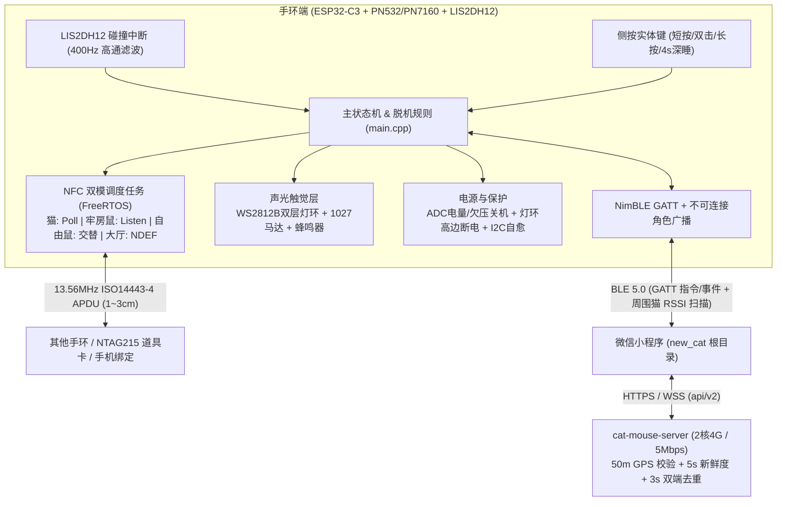

# 猫鼠手环 V1.5 硬件架构设计基线（Architecture Freeze）

> 状态：V1.5 基线冻结（2026-11-27）  
> 适用范围：10 套免画板手焊原型（POC）→ 100 套定制 PCBA 试产（EVT/DVT）→ 1,000+ 套开模量产（MP）  
> 配套软件：`one-num-three/new_cat`（微信小程序 + `cat-mouse-server` API v2）

---

## 1. 第一性原理：为什么要做“轻硬件 + 强手机 + 双模 NFC”？

线下真人猫抓老鼠最核心的 4 个痛点，决定了整个硬件架构的边界：

| 现场痛点 | 错误做法（常见坑） | 本架构决策（第一性原理） |
|---|---|---|
| 抓捕靠口头喊或掏手机扫码太慢、容易扯皮 | 纯靠 GPS/BLE RSSI 自动判抓（人体遮挡误差 3–15m，误判极多） | **碰撞中断唤醒 + 13.56MHz 双模 NFC 贴合 0.5s 双向握手**，1–3cm 物理接触才生效，零扯皮；同时保留现有小程序动态码兜底 |
| 玩家奔跑中需要全场地定位与联网 | 手环内塞 GPS + 4G Cat.1（BOM 暴涨 ¥60+、天线在手腕遮挡搜星慢、重量超 60g、续航崩盘） | **人手一台手机做 GPS 与 4G/5G 网关**；手环只做低延迟传感、声光触觉交互和 NFC 握手，通过 BLE 与宿主手机互联，BOM 压到量产 ¥70 级 |
| 天黑/树荫/户外混战分不清阵营、跑起来不看手机 | 依赖手机屏幕看状态，或只用单颗小 LED 指示灯 | **12 颗高亮 RGB 环形灯阵 + 乳白柔光导光罩 + 1027 强振感马达 + 无源蜂鸣器**，10 米外一眼辨阵营，不看手机靠振感与音效即可盲操 |
| 单一“猫抓鼠”新鲜感消退快 | 把手环做死成“猫发/鼠收”单向标签 | **全员同等配置双模 NFC（读卡 + 卡模拟）**，靠固件按角色动态切换 Poll/Listen，天然解锁“队友碰触解救”“场地 NTAG215 道具卡/据点”“手机碰一碰绑定”“阵营传染/感染模式” |

---

## 2. 系统分层架构

---

## 3. 核心技术决策与防踩坑设计

### 3.1 为什么用“碰撞唤醒 + 短时 NFC 窗口”而不是常开 NFC 轮询？
- **功耗差异**：PN532 射频常开耗电约 **60–100 mA**，250–300 mAh 电池撑不过 2 小时；采用 LIS2DH12 硬件单击高通滤波中断（`< 0.1 mA`）检测到碰撞（或玩家主动短按按键）时才唤醒 PN532 开启 **1.5 秒交互窗口**，平均 NFC 功耗骤降至 **3–8 mA**。
- **防冲突**：自由鼠在窗口内采用 **600ms Listen（优先被抓） / 300ms Poll（救队友与捡道具）** 的非对称时隙交替，避免两只手环同时处于 Poll 发射射频场而互相听不见。
- **防重放与跨场防误读**：NFC 双向 `HELLO` APDU 携带 `bandId(6B) + role(1B) + team(1B) + session(4B) + captureNonce(2B)`，服务端交叉比对双端上报的 `EVT_NFC_PEER` 并结合现有 `api/v2` 的 **50m GPS 距离校验 + 5s 新鲜度 + 3s 防重放**，彻底杜绝场外蹭刷或手机模拟作弊。

### 3.2 电气保护与可靠性“五道保险”
1. **灯环高边断电控制（解决 12mA 静态漏电）**：WS2812B/SK6812 灭灯时每颗仍有约 1 mA 静态漏电。固件新增 `PIN_LED_PWR` 电源使能控制（量产 PCBA 接高边 PMOS，灭灯/隐身/深睡时先拉低 `PIN_LED_DATA` 再断开电源，防止 GPIO 通过保护二极管反灌电流；原型阶段用物理拨动开关兜底）。
2. **电池低电告警与过放自动深睡（LVP）**：ADC 定时均值滤波采样；`< 3.55V`（约 10%）触发红灯低电提醒与 `EVT_BATTERY` 上报；连续 3 次采样 `< 3.30V` 自动安全关机进入深睡（`< 25 µA`），保护锂聚合物电芯寿命。
3. **I2C 总线死锁自愈（9-Clock Bus Recovery）**：户外奔跑静电或接触瞬断可能导致从机拉死 SDA；总线连续通信错误时，固件自动切回 GPIO 开漏输出 9 个 SCL 时钟脉冲 + STOP 条件并重建 I2C，无需拆壳拔电池重启。
4. **马达反电动势吸收**：1027 偏心转子马达感性负载关断瞬间产生高压尖峰，硬件必须在马达两端反并 `1N4148` 续流二极管，AO3400 MOS 管栅极串 `100Ω` 并对地接 `100kΩ` 下拉电阻，确保芯片复位瞬间马达不会误抖。
5. **BLE 连接态持续角色广播**：手环连上宿主手机后，自动从可连接广播（`BLE_GAP_CONN_MODE_UND`）切为**不可连接广播（`BLE_GAP_CONN_MODE_NON`）**，厂商数据持续携带 `role / team / battPct / session`，既防止路人手机误连，又让周围鼠玩家的小程序能持续扫到附近猫的 RSSI，实现“10 米内心跳预警”。

---

## 4. 从原型（POC）到量产（MP）的平滑演进路径

| 维度 | 阶段 1：V1.5 手焊原型（10 套） | 阶段 2：EVT/DVT 定制 PCBA（100 套） | 阶段 3：MP 开模量产（1,000+ 套） |
|---|---|---|---|
| **主控** | Seeed XIAO ESP32C3 开发板 | ESP32-C3-MINI-1 模组（已过 SRRC） | ESP32-C3-MINI-1（或 ESP32-C5 支持 5G 室内指纹） |
| **NFC 方案** | PN532 迷你 I2C 模块 | **NXP PN7160** 或 **ST25R3916B** + 环形 FPC 天线 + 0.2mm 铁氧体屏蔽片 | 同 EVT，天线与灯环同心一体优化，读距稳达 2.5–3.5cm |
| **灯环** | WS2812B 12 灯现成灯环 | SK6812-MINI-E × 12 + 高边 PMOS 断电 + 乳白 PC 扩散罩 | 同 EVT，注塑定制光学导光环，日光下 15m 可辨 |
| **电源与充电** | 250mAh 电池 + XIAO USB-C + 拨动开关 | 300mAh 带 NTC 温控电池 + BQ25180 + 磁吸 Pogo-Pin | 350mAh 高倍率电芯 + 20 联磁吸充电收纳箱 |
| **防水防摔** | 嘉立创光敏树脂 3D 打印（IP54） | CNC / 硅胶复模外壳（IP54） | ABS+PC 双色注塑 + 硅胶密封圈（IP65） |
| **预留升级** | XIAO ESP32S3 Sense 单套预研语音 | PCB 预留 MEMS PDM 麦克风 + 气压计（BMP581）焊盘 | 高配版贴装气压计（楼层）+ 麦克风 / UWB |
| **固件兼容** | 本仓库 `hardware/firmware/` 原生运行 | 仅需替换 `config.h` 引脚映射与 NFC HAL 驱动层，业务状态机 100% 复用 | 支持 BLE OTA 空中升级新玩法灯效/规则 |

---

## 5. 可验证的架构成功指标（Done Criteria）

1. **真实 C++ 固件源码通过原生编译器（`zig c++` / `clang++` / PlatformIO）零警告、零错误编译**。
2. **多手环硬件在环仿真（20 人局全流程 + 边界故障压测）100% 通过**：
   - 猫撞鼠抓捕（含 3s 防重放、跨场 session 拦截、50m GPS 校验通过与超距拒绝）
   - 自由鼠救牢房队友（Listen/Poll 交替零死锁）
   - 自由鼠/猫刷 NTAG215 道具卡
   - iPhone (`P1=0x02`) & Android (`P1=0x00`) 手机大厅碰一碰读取 NDEF 绑定链接
   - 猫靠近 BLE 不可连接广播扫描触发心跳振感
   - 低电告警（3.50V）与过放自动深睡保护（3.25V）+ 灯环电源切断校验
   - I2C 总线异常恢复与串口产测自检 CLI 全命令通过
3. **20 分钟高强度对局模拟电量消耗 ≤ 35%（300mAh 电池可连续支撑 ≥ 3 局）**。
