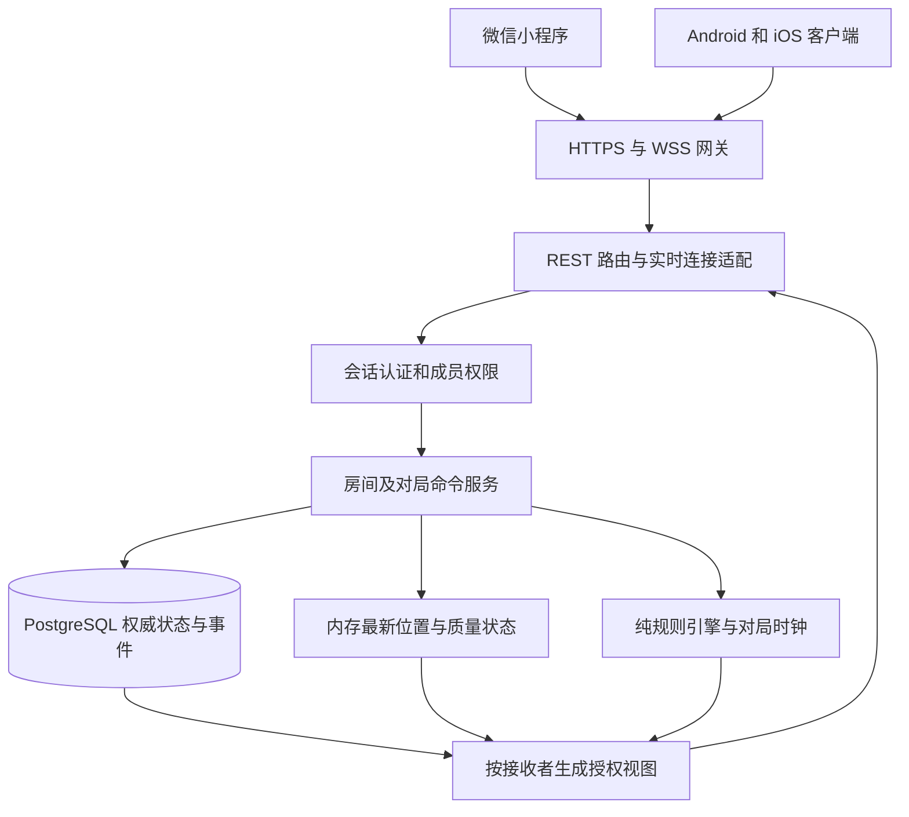

# 猫鼠游戏技术架构与实施路线

日期：2026-10-08。资源约束：具备微信小程序、Android 和 iOS 开发能力，自有服务器4核、4GB内存、5M带宽。建议在原仓库演进为“服务端统一裁决的模块化单体＋持久化数据库＋按玩家授权的实时同步＋平台适配客户端”。保留原生微信入口，App 做独立定位验证后接入同一协议。

本次交付是架构和实施方案，以及本地缺陷复现证据。没有更换业务实现、部署服务器或完成负载测试。前置决策见 [总体产品报告](01-总体产品规划报告.md) 与 [游戏产品报告](02-非对称对抗与游戏产品报告.md)。

## 1 当前工程的实情

地图页有2,202行JavaScript，混合定位、请求、阵营、视野、任务、奖励、技能、绘图、动画和结算。后端1,091行，路由直接修改缓存，缺少统一身份、领域规则、事务和对局时钟。前端每2秒拉完整状态，定位回调节流下限500毫秒；Socket.IO服务端存在，客户端没有完整接入。

本次复现的关键结果：无身份可改设置、接管房主、选择胜方；抓捕无需二维码凭据和位置；隐身未保存；全员位置匿名可读；胜方未返回；已结束局可重开覆盖。技术问题中心是状态、权限和接口契约没有统一。

源代码事实锚点：`server.js:37` 缓存、`:128` 加入、`:218` 设置、`:265` 开始、`:368` 状态、`:475` 位置、`:515` 抓捕、`:611` 道具、`:675` 结束、`:1070` Socket入房；`map.js:519` 状态轮询、`:762` 结算、`:1415` 二维码；`utils/api.js` 请求封装。仓库HEAD是 `01a0460`，审计基于其未提交工作区；后端哈希与测试记录见 [证据文件](evidence/baseline-results.json)。

### 1.1 旧代码怎样复用

| 内容 | 建议 | 复用前的条件 |
| --- | --- | --- |
| 微信工程、导航入口、地图接入 | 保留工程入口，重做页面和控制器 | 真机验证坐标、权限、地图层级和回前台 |
| 创建/加入/开始/抓捕的业务词汇 | 作为新用例和协议的起点 | 修正身份、状态迁移与幂等 |
| Haversine距离函数 | 提取为独立工具 | 测试零坐标、相同点、异常数值、坐标系一致性 |
| Express与HTTP部署经验 | 保留，迁移到TypeScript模块 | 路由只校验输入和调用服务，不直接改状态 |
| utils/api.js | 仅保留统一访问层的意图，重写 | 任意POST自动重试、丢Authorization的重试、只认200、日志泄露都需处理 |
| Socket.IO服务端 | 作为事件清单参考 | 不直接保留无鉴权房间广播 |
| NodeCache | 从权威状态存储中替换 | 内存只能做可恢复缓存和最新定位 |
| 旧WXML/WXSS | 参考流程，不整套迁移 | 新设计组件、布局、可访问状态与真实数据契约 |
| 题库和实验页面 | 保留在实验目录/历史提交中 | 经单独玩法评估后再迁移，不能直接启用 |
| Docker与打包脚本 | 保留发布思路，调整源目录和镜像 | 新产物清单、Node版本、非root运行、健康/就绪检查 |

不建议以“旧代码保留百分比”作为目标。真正可复用的是平台接入经验、已明确的场景和可验证的工具函数。

## 2 目标架构



一个服务进程、一个数据库、一个反向代理即可作为第一阶段部署。暂不引入微服务、消息队列集群或Kubernetes。4核不要求开4个游戏进程；先保证一个对局只有一个串行写入者，再根据测试考虑多进程。

### 2.1 模块边界

| 模块 | 负责 | 不负责 |
| --- | --- | --- |
| Identity | 平台登录换取内部userId、会话、设备会话撤销 | 房间规则 |
| Room | 邀请码、成员、准备、组织者、预设 | 用房间号作为所有局的历史ID |
| Match | 阶段、阵营、目标、截止、终局 | 信任客户端决定胜方 |
| Location | 坐标系、精度、时序、异常跳变、最新有效位置 | 保证物理世界绝对真实 |
| Visibility | 按阵营/阶段/时效生成可见位置和区域线索 | 把全图发送后让前端隐藏 |
| Capture | 动态凭据、原子捕获、争议裁决 | 无限期冻结倒计时 |
| Presence | 心跳、定位失效、重连、异常暂停 | 把TCP连着等同于位置有效 |
| Results | 团队结果、个人状态、有限事件记录 | 修改已提交终局来适配UI |
| Transport | REST、WSS、序号、ACK、降级 | 自己复制一套游戏规则 |

规则引擎建议暴露 `decide(state, command, now, rules) -> decision`。服务层加载状态、验证身份、串行执行、提交事务，再生成事件。时钟和随机数源可注入测试，领域模块不依赖微信、Express、数据库或UI。

## 3 多端实现选择

推荐“微信原生小程序＋可选Flutter App＋同一服务端协议”。微信页可以改用TypeScript构建并拆组件；App若选择Flutter，用平台通道接入Android/iOS定位生命周期。共享的是协议、状态语义、设计规范和测试样例，不能假设微信页面代码可以直接变成原生App。

| 方案 | 优点 | 代价 | 本项目判断 |
| --- | --- | --- | --- |
| 原生微信＋Flutter App | 各自处理平台能力，App两端共享较多UI | 两套展示代码；平台定位仍需原生适配 | 默认建议 |
| uni-app覆盖多端 | 适合希望集中在Vue/JS栈的团队 | 地图、相机、后台定位仍有端差异，原生微信页也需迁移 | 若熟悉该栈，先做地图与定位样机比较 |
| 微信＋Android/iOS各自原生 | 对平台行为控制直接 | 三套UI和状态适配需要持续维护 | 已有成熟原生组件时可选 |
| WebView包装旧页面 | 初期看似省事 | 无法自然继承微信API，后台定位仍需重做 | 不作为当前方案 |

Flutter支持通过平台通道调用Kotlin/Swift等代码，并不免除后台定位实现工作。[Flutter平台通道文档](https://docs.flutter.dev/platform-integration/platform-channels) uni-app提供跨端开发能力，具体关键API仍需在目标设备验证。[uni-app官网](https://uniapp.dcloud.net.cn/)

客户端架构统一为：页面/组件 → 展示状态模型 → GameSession → API/实时连接、定位、扫码、存储适配器。地图中心、玩家真实坐标、授权敌方线索分别存储。前端不计算权威胜负，也不以本地倒计时结束对局。

建议首批组件：RoleBadge、MatchClock、ConnectionBanner、PlayerReadiness、PrimaryAction、IntelMarker、ResultSummary、HostControls。顶部、底部用统一安全区；平台API返回px就用px，不混成rpx。

### 3.1 定位样机的淘汰门槛

用Android、iPhone和微信分别测试前台10分钟、锁屏5分钟、切其他应用5分钟、相机扫码返回、网络切换与拒绝精确定位。记录服务端收到的位置间隔、位置年龄、耗电和恢复时间，不只记录“API调用成功”。

Android普通后台定位可能被降到每小时少数几次，需结合定位前台服务和权限验证。[Android官方文档](https://developer.android.com/about/versions/oreo/background-location-limits) iOS后台位置需要配置相应能力并控制后台更新；不能假定普通定时器或长连接在挂起后仍按秒执行。[Apple官方文档](https://developer.apple.com/documentation/corelocation/cllocationmanager/allowsbackgroundlocationupdates)

当前微信工程只声明前台位置相关接口。后台接口有类目和开通限制，先查看实际账号能力，不能从开发工具运行成功推断提审可用。[腾讯位置服务后台定位说明](https://github.com/TencentLBS/tencentmap-miniprogram-skill/blob/main/references/wx_location_api/wx.startLocationUpdateBackground.md)

后台定位与后台网络送达是两项能力。App样机还必须验证定位回调触发时的上报；断开实时通道后用受控HTTPS上报/恢复，不能通过高频轮询尝试绕过系统挂起。通知只用于告知，不承担实时裁决。

## 4 身份、数据和状态模型

### 4.1 身份分层

`userId`为内部账户；`roomMemberId`为房间成员；`matchParticipantId`为当局玩家。客户端显示的昵称、微信openid、邀请编码都不能代替内部主键。微信code由后端校验后建立会话；App可先使用服务端签发的可撤销匿名会话，再按需求绑定账户。不同平台账户不能仅凭同名合并。

邀请码只用于查找和加入，不能授权查看精确位置。4位码可以保留为内部实验；对外建议更大编码空间＋速率限制＋唯一索引/原子重试。ownerId由创建会话确定，不能接受请求体的isOwner。所有读取、订阅和写入都验证成员关系。

### 4.2 最小数据表

| 表或数据 | 主要字段 | 存放位置 |
| --- | --- | --- |
| users / identities / sessions | 内部用户、平台映射、会话哈希、到期与撤销 | PostgreSQL |
| rooms / room_members | 内部ID、邀请码、组织者、准备、成员关系 | PostgreSQL |
| matches | roomId、rulesVersion、phase、stateVersion、endsAt、pauseBudget、result | PostgreSQL |
| match_participants | 当局阵营、active/captured/withdrawn、捕获计数 | PostgreSQL |
| match_events | matchId、连续eventSeq、类型、操作者、服务端时间、公开/私有负载 | PostgreSQL |
| capture_tokens / commands | 凭据哈希、目标、有效期、消耗；commandId和结果 | PostgreSQL，和捕获事务一起提交 |
| venue / rules_snapshot | 确认场地、集合点、初始人数、规则参数副本 | PostgreSQL |
| latest_positions | memberId、lat/lng、坐标系、accuracy、采样/接收时间、位置序号 | 单进程内存；周期性恢复快照可选 |

建议数据库作为对局权威存储，Redis暂不必需。PostgreSQL保存关键状态和事件；最新定位高频放内存，不能每次位移都覆盖整份房间大对象。若后续多进程共享位置和会话，再引入Redis，并明确其持久化、恢复与权威边界，不能认为“换Redis”自动解决丢数据。

活动结束后精确位置从内存移除。默认不建立完整轨迹库；结果只存所需统计。现场诊断若临时采集位置，应设独立用途、权限和短期清理策略。备份中也要考虑过期数据的生命周期。

### 4.3 状态机和时间

```text
房间 WAITING → READY → 开始一局，产生新的 matchId
对局 HIDING → CHASING → FINISHED
HIDING / CHASING → PAUSED → 恢复原阶段或 CANCELLED
FINISHED / CANCELLED → 不再变更胜方；房间可创建下一局
```

暂停保留阶段剩余时长，恢复后由服务器生成新的endsAt；凭据失效重签。终局包含 `outcome=cat_win|mouse_win|cancelled`、`reason`、`endedAt`、`stateVersion`。使用唯一终局约束和事务，重复结束不生成第二个结果。

调度器按截止时间处理，重启后扫描未终结对局并转恢复暂停。任何写命令执行前也检查当前时间及阶段，避免只有GET /status才触发超时。倒计时显示用服务器时间偏移估计并定期校正，不用连续减1决定获胜者。

## 5 抓捕、位置和并发正确性

抓捕命令至少携带 `commandId`、`matchId`、`captureToken`。操作者从会话读取。服务端检查成员、阶段、截止、目标状态、凭据绑定与有效期、位置质量后，单事务消费凭据、改变目标状态、增加捕获计数、写事件并判断终局。

对每个match串行处理命令，数据库用行锁或版本条件更新兜底；不能只因Node单线程就忽略异步I/O引入的交错。相同commandId返回已保存的同一结果；两只猫同时抓一只鼠，只有首个合法事务成功，另一方得到明确的ALREADY_CAPTURED。

位置上报包含 `sampleSeq`、`sampledAt`、`lat`、`lng`、`coordinateSystem`、`accuracy`，服务器增加 `receivedAt`。验证有限数值、经纬度范围、序号递增、时间合理和跳变异常。客户端时间与精度都不完全可信，不能作为防伪证据；过期、异常位置不用于抓捕。

微信当前使用GCJ-02；多端上线前必须统一用于计算的坐标系。建议在地图SDK适配层统一输出约定坐标，保留来源标识；未知坐标系拒绝进入距离计算，跨端实地同点校验，不能把WGS-84与GCJ-02直接相减。

服务端所有响应采用白名单DTO。`publicRoster`只给姓名、阵营、公开状态；`visiblePositions`只给本接收者获准的位置；`intel`给区域和有效期。结束事件、错误信息、重连全量快照、Socket订阅和裁判视图都不能绕过这些边界。

## 6 实时通信与重连协议

推荐REST处理登录、建房和需要可靠结果的命令，原生WSS下发授权事件和位置批次。微信使用平台Socket适配，App使用相应连接库；保持业务协议简单。当前Socket.IO实现不能直接用原生WebSocket客户端连接，它具有自己的帧协议。[Socket.IO官方说明](https://socket.io/docs/v4/)

若团队选择保留Socket.IO，则先完成微信/Flutter客户端兼容样机，不能同时维护两套权威事件定义。本方案默认选择原生WSS，服务端可采用成熟WebSocket库，补齐认证、心跳、重连和序号。

| 数据 | 建议起始频率 | 可靠性规则 |
| --- | --- | --- |
| 移动中上报位置 | 2秒一次；静止最多5秒一次 | 最新覆盖旧的，过期数据不补发 |
| 前台授权位置更新 | 每2秒合并一次 | 按接收者过滤；不对每次上报立刻广播全房间 |
| 阶段、抓捕、终局事件 | 提交后立即发送 | 持久化eventSeq，断线可补发或获取快照 |
| 心跳 | 5秒 | 心跳存活不代表位置新鲜 |
| 对局快照 | 入场、重连、版本缺口时 | 返回完整但按权限裁剪的状态 |
| 实时降级 | 明确断开WSS后单飞轮询 | 降级期间不同时运行两套全量轮询 |

事件信封可为 `{protocolVersion, matchId, eventSeq, stateVersion, serverTime, type, payload}`。客户端丢弃旧版本状态；事件seq缺口请求补发或重取快照。位置另用单调positionSeq，可丢旧位置，不要求补发每个采样点。

持久事件提交与推送间可能宕机，所以采用数据库事件表/简单outbox：先事务提交，再推送。收到重复事件按序号去重；错过推送可从数据库恢复。API自动重试仅限安全读操作或带commandId的命令。

慢连接设置有界发送队列：合并位置帧，保留必要状态事件；队列超过限制就断开并要求快照恢复，不能让一个慢设备撑爆进程内存。

## 7 4核4G与5M带宽容量估算

以下把用户说的“5M”按公网出口5Mbps计算。如果实际是5MB/s、共享峰值或同时承载其他业务，需要重算。未登录实际服务器，CPU型号、磁盘、操作系统、线路和可用资源未测，不能承诺最大并发。

5Mbps ÷ 8 = 625,000字节/秒，约610KiB/s。建议以持续3Mbps作为初始业务出口预算，给协议开销、突发重连及其他业务留余量。不是把全部5Mbps用满再算成功。

### 7.1 旧协议的本地载荷测量

脚本创建测试成员、开始对局并给每人提交有效坐标，直接测量JSON响应UTF-8字节数。昵称和ID较短，没有大量历史事件，不含HTTP头、TLS和传输重发，实际业务可能更大。

| 单房人数 | 单次status正文 | 全站100人每2秒拉一次的正文出口 |
| --- | --- | --- |
| 6 | 3,372字节 | 1.349Mbps |
| 12 | 6,489字节 | 2.596Mbps |
| 20 | 10,665字节 | 4.266Mbps |

计算：`单响应字节 × 在线人数 × 每秒请求次数 × 8 / 1,000,000`。这里100人是全站同时在线，不是100个房间；假设他们处于对应规模的房间。旧20人房间情形下，单是status正文已经接近5M上限，还没计位置上传响应、请求头和重连。

旧客户端位置上传最多约2次/秒，100人极端情况下还有约200次位置请求/秒和50次status请求/秒。实际频率依赖设备位置回调，不能把节流上限当作稳定实测QPS。

### 7.2 新协议的设计预算

假设每个授权可见位置编码约100字节、每人最多19个可见目标、每2秒合并发送一次，100人则位置正文约 `100 × 19 × 100 × 0.5 × 8 = 0.76Mbps`。按额外50%粗略冗余约1.14Mbps；200人为约2.28Mbps。这个数字仅是设计假设，必须测真实序列化、帧头、状态事件和重连突发，不能称为已支持200并发。

完整房间广播的成本会随房间人数平方增长。不要把每人的每次位置更新都广播给全部在线人；房间隔离、按接收者过滤、合并批次和去掉双份players才是真正节省带宽，换成WebSocket本身不会消除广播成本。

初始服务目标建议为5个房间、每房最多12人，即60人同时在线；首先进行本地仿真，再用真实服务器和网络测试。通过后逐步测100人、200人。第一版准入上限应由压测和真机活动确定，不按数学上限开放。

### 7.3 资源规划与升级顺序

| 部件 | 初始规划预算 | 注意事项 |
| --- | --- | --- |
| 系统与网关 | 约512MiB | 以真实基础占用为准 |
| Node服务 | 512–768MiB | 包括连接、缓冲和房间；监控RSS与事件循环 |
| PostgreSQL | 约768MiB–1GiB | 限制连接池，从5–10个连接起步 |
| 轻量监控与备份任务 | 约256MiB | 避免在同机部署重型日志平台 |
| 余量 | 至少约1GiB作为目标 | 共享机器需扣除已有服务，预算不是实测 |

不在这台服务器上现场编译App或执行大型构建；只运行产物。地图瓦片由合适的地图SDK服务提供，活动图片与安装包使用对象存储/CDN或分发服务，不占5M游戏出口。具体地图SDK授权、配额和计费在选型时确认，不能默认免费无限用。

先修响应和频率；若持续出口超过约3Mbps，优先增加带宽或分离静态资源；若CPU或事件循环先饱和，定位序列化、数据库和广播热点；房间规模确实超出单进程再做按房间分片。4核4G对小规模目标具备合理起点，但仍有单机故障域。

## 8 单机部署和恢复

建议Linux环境下用Docker Compose运行网关、Node、PostgreSQL三个服务，数据库只监听内部网络，公网只开放HTTPS/WSS和受控运维入口。若现有服务器不是该环境，应保留相同边界调整部署方式。

当前Dockerfile是 `node:20-alpine`；截至本报告日期，官方发布页已列Node20为EOL。新版本选择Node24 LTS的已验证补丁版本并固定镜像摘要，依赖重新验证；不把本地复现用的Node22.17.1当作生产推荐版本。[Node.js发布状态](https://nodejs.org/en/about/previous-releases)

配置统一到环境变量：数据库连接、会话签名、平台密钥、域名和环境标签；客户端只包含可公开配置。生产日志记录requestId、commandId、matchId、错误码和耗时，不记录token、微信code和完整位置请求。当前app.js与api.js大量调试日志需要替换。

健康检查分liveness和readiness；数据库不可写时不接受新对局。每日备份关键数据到另一位置，并做恢复演练。已确认抓捕必须先落事务才响应；数据库不可写则拒绝指令并暂停，不给用户虚假的成功提示。主机整体损坏时恢复能力取决于异地备份频率，不能承诺高可用。

发布先停止创建新房间，让进行中对局自然结束；不以重启整机完成升级。恢复演练目标可设10分钟内恢复服务、进程重启不丢已确认抓捕，但这些是待验收目标。服务器重启后位置必须重新采样，不能使用恢复快照继续判距离。

## 9 在原仓库中的实施路线

保留历史基线，建议未来新增以下结构；这是结构提案，本次未搬迁源码：

```text
apps/
  wechat/                 微信客户端与平台适配
  mobile/                 App正式启动后再建
services/
  api/src/
    identity/ rooms/ matches/ locations/
    captures/ visibility/ presence/ transport/
packages/
  contracts/              JSON Schema或OpenAPI、事件契约
  rules/                  服务端规则与确定性测试
  design-tokens/          配色、间距、字体等基础规范
tests/
  integration/ protocol/ load/
infra/                    容器、网关、备份、发布
reports/                  历史审计与决策依据
```

### 9.1 分阶段任务与验收

以下人日按一名熟悉项目的开发者集中投入估算，不含平台审核排队和协调玩家时间；用户具备多端能力并不等于已经有多名开发者。实际排期取决于样机验证及首轮范围。

| 阶段 | 工作量估计 | 具体交付 | 通过条件 |
| --- | --- | --- | --- |
| T0 规则与设计 | 3–5人日 | 规则v0.2提案、一屏规则、五类关键UI、状态契约 | 猫/鼠/组织者都能明确执行，无无效配置 |
| T1 平台能力样机 | 2–4人日 | 微信、Android、iOS位置与生命周期测试记录 | 明确主端；锁屏要求有可行路径 |
| T2 可信后端 | 6–10人日 | 身份、房间、对局状态机、数据库、动态抓捕、授权视图 | R01–R15相关问题变为失败请求或正确结果；终局唯一 |
| T3 微信新体验 | 5–8人日 | 新页面/组件、定位服务、准备流程、扫码与结果 | 双设备完整闭环，退出不残留监听 |
| T4 同步和运维 | 3–5人日 | WSS、序号恢复、降级、日志、备份、部署演练 | 弱网与重启恢复正确；60人目标负载达标 |
| T5 场地迭代 | 3–5人日开发工作 | 3场活动观察、修复、单变量调参 | 可以解释取消/争议，达到产品门槛后扩大 |

受控试点版合计约22–37人日，是含设计、能力验证和测试的粗估，非上线承诺。App正式UI与分发若启动，另估10–20人日以上，定位SDK和双端适配会影响范围；平台账号、域名与审核不包含在内。

第一条纵向切片应完成“两个人用新会话入房 → 服务端授权位置 → 签发动态码 → 捕获只记一次 → 两端同一结算”。这一步先证明架构正确，再铺完整多人的规则和新UI。

### 9.2 迁移与回滚

新协议使用 `/api/v2` 与明确的protocolVersion；旧接口只用于隔离开发样本，不继续对公网开放已知不可信写入。新旧客户端不能混入同一局；每局记录client最低版本和rulesVersion。

按房间切换实现，不把进行中的旧NodeCache对局强行转换成新状态。旧代码用Git保留，过渡期可作本地对照。不能双写两套规则后再让客户端决定相信哪一个结果。

数据库先做可向后兼容的增量迁移，保留备份；回滚应用不能把已确认的捕获和结果删除。发现发布问题时先停止新房、保持既有局的规则版本，必要时明确取消受影响对局。

## 10 必须覆盖的测试

| 层级 | 关键用例 |
| --- | --- |
| 规则单测 | 阵营数合法、捕获配额、时间边界、暂停预算、终局不可逆、轮换规则 |
| 契约测试 | winner/outcome存在、所有平台识别相同错误码、隐藏字段不存在、未知规则版本拒绝 |
| 接口集成 | 冒充身份、抢房主、重复join、两猫同时抓捕、token跨局/过期/重放、命令重试 |
| 实时恢复 | 重复/乱序事件、位置丢包、ACK丢失、WSS中断、快照恢复与轮询互斥 |
| 生命周期 | 被捕、取消、退出、相机返回、后台/锁屏、重进页面、定位拒绝、会话过期 |
| 位置测试 | 同点跨端、零坐标、异常经纬度、坐标系不匹配、位置过期、精度劣化 |
| 故障测试 | 事务前后进程退出、推送前宕机、数据库不可写、快照/备份恢复 |
| 负载测试 | 60→100→200人、多房间、满房20人对照、30%同时重连、1小时稳态 |
| 场地测试 | 首捕时间、定位争议、信息可理解性、退出处理、太阳下可读性与耗电 |

负载门槛建议：稳态出口≤3Mbps、RSS≤预定预算、无持续队列增长；服务内命令处理p95<100ms，测试线路端到端命令p95<500ms、p99<1.5秒，位置可见年龄p95≤5秒。网络故障期间单列统计，不能删掉失败样本美化结果。压测不替代真实公网线路和手机测试。

## 11 本次审计如何复核

已添加 [本地复现脚本](evidence/audit-baseline.cjs) 与 [16项结果和载荷样本](evidence/baseline-results.json)。脚本仅把服务监听重定向为localhost随机端口，业务代码与规则未替换，关闭任务及进程内HTTPS。所有测试房间只存在于子进程内存，结束即随进程消失。

复现时在临时目录放现有package.json和lockfile并运行 `npm ci --ignore-scripts`，然后执行：

```powershell
node reports/2026-10-08/evidence/audit-baseline.cjs <临时依赖目录> <可选结果JSON路径>
```

脚本断言的是“旧缺陷可以重现”，不是健康测试；未来修复后断言失败可能代表缺陷已消失，需改成正确行为的回归测试。结果包含运行时生成的时间戳，报告日期以2026-10-08为准。载荷测量使用短ID、短昵称和空事件列表，仅作为带宽估算输入。

当前没有真机视觉验收、后台权限获批证明、真实场地平衡性数据或自有服务器压测结果。因此建议的工程起点是T0/T1与最小可信闭环；满足门槛后继续T3–T5，在原项目上迭代完成重构。
